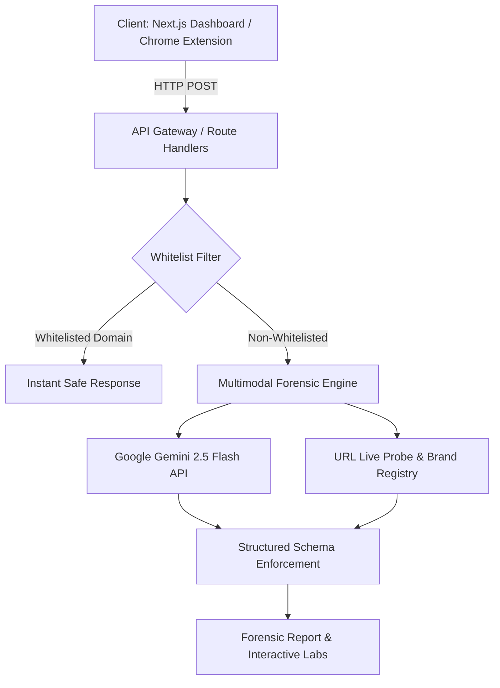

# ScamShield Forensic AI

> **Multimodal Cyber Forensics & Cognitive Deception Intelligence Platform**  
> Powered by **Google Gemini 2.5 Flash** for automated fraud detection, evidence benchmarking, and adversarial simulation.

---

## Abstract & Overview

Online social engineering and multimodal cyber deception—including SMS brand spoofing, crypto wallet drainers, deepfake impersonation, and fake government portal malware—present critical threats to digital safety. 

**ScamShield Forensic AI** provides an end-to-end cyber-forensic pipeline that analyzes suspicious screenshots, text messages, and web URLs. Combining multimodal LLM reasoning (Gemini 2.5 Flash) with deterministic live web intelligence and brand verification, the system extracts concrete violation evidence, decodes psychological manipulation tactics, benchmarks suspect claims against verified ground truths, and provides an interactive defense reflex training environment.

---

## Key Features

1. **Multimodal Forensic Scanner**
   - Ingests image screenshots (OCR + visual artifact analysis) or raw text/links.
   - Computes deterministic risk scores (0–100) and severity threat tiers (`SAFE`, `LOW`, `MEDIUM`, `HIGH`, `CRITICAL`).

2. **Web Intelligence & Live Verification**
   - Active URL extraction and HTTP live probe verification.
   - Domain matching engine benchmarking claimed brand identities against authoritative registries.
   - High-risk TLD detection (`.vip`, `.top`, `.xyz`, etc.).

3. **Ground Truth Evidence Comparator**
   - Structural 3-tier comparative cards juxtaposing:
     - 🔴 **[Detected in Data]**: Specific suspicious indicators discovered in the input.
     - 🟢 **[Official Benchmark]**: Authoritative baseline or legal regulations with verified source links.
     - 💡 **Analysis**: Technical rationale explaining why the disparity indicates fraudulent intent.

4. **Cognitive & Psychological Deception Decoder**
   - Unmasks psychological triggers (e.g., urgency coercion, artificial scarcity, FOMO, sunk cost entrapment).
   - Identifies targeted human emotions and predictive adversarial next moves.

5. **Adversarial Roleplay Reflex Lab**
   - Conversational simulation powered by Gemini 2.5 Flash.
   - Users practice defensive responses against dynamic scammer personas based on the scanned case.
   - Real-time reflexive evaluation (`Safe Defensive Response` vs `Critical Defense Failure`).

6. **Instant Cross-Platform Warning Cards & PDF Export**
   - 1-click formatted family warning dispatch via Telegram, messaging intents, or native Web Share API.
   - Comprehensive high-resolution PDF forensic report generator for investigative documentation.

7. **Manifest V3 Chrome Extension**
   - Real-time active tab inspection injecting high-contrast warning overlays when navigating to malicious domains.

---

## System Architecture



---

## Tech Stack

| Layer | Technology |
|---|---|
| **Frontend Framework** | Next.js 16 (App Router), React 19, Tailwind CSS 4 |
| **Icons & Visuals** | Lucide React, HTML5 Canvas, jsPDF |
| **AI / Multimodal Reasoning** | Google Gemini 2.5 Flash (`@google/genai` SDK) |
| **Extension** | Google Chrome Extension Manifest V3 |
| **Deployment & Container** | Docker, Google Cloud Run |

---

## Local Development & Setup

### Prerequisites
- Node.js 20+
- Google Gemini API Key from [Google AI Studio](https://aistudio.google.com/apikey)

### Installation

```bash
# Clone the repository
git clone https://github.com/maingiangu-svg/ScamGuard-AI.git
cd ScamGuard-AI/scamshield-forensic

# Install dependencies
npm install

# Configure environment variables
cp .env.example .env.local
# Set your GEMINI_API_KEY in .env.local

# Launch development server
npm run dev
```

Navigate to `http://localhost:3000` in your web browser.

---

## Chrome Extension Setup

1. Open Google Chrome and navigate to `chrome://extensions`.
2. Toggle on **Developer mode** in the top-right corner.
3. Click **Load unpacked** and select the `extension/` directory.
4. The extension will automatically monitor active navigation and cross-reference against the local ScamShield API at `http://localhost:3000/api/analyze`.

---

## Cloud Deployment (Google Cloud Run)

```bash
export GCP_PROJECT_ID="your-gcp-project-id"
export GEMINI_API_KEY="your-gemini-api-key"
chmod +x scripts/deploy-cloud-run.sh
./scripts/deploy-cloud-run.sh
```

---

## License

This project is licensed under the MIT License.
